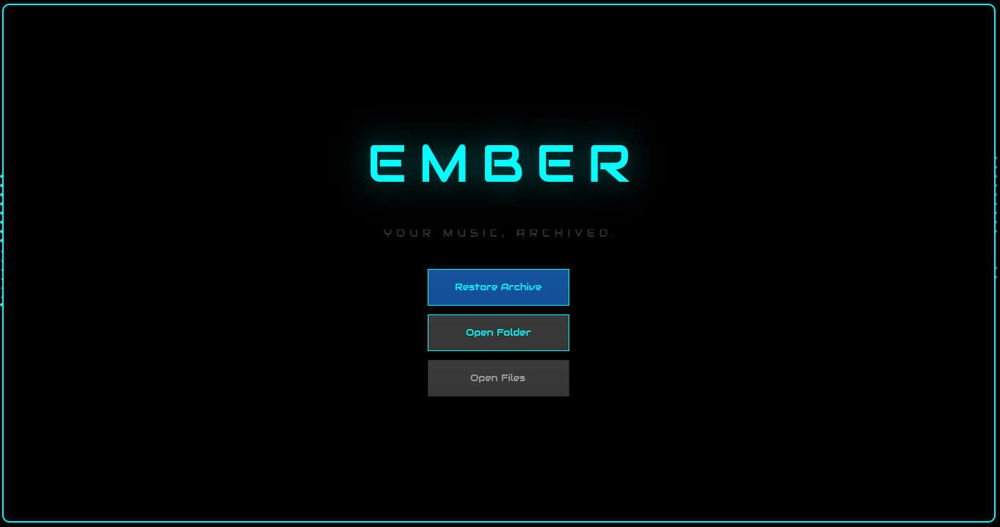
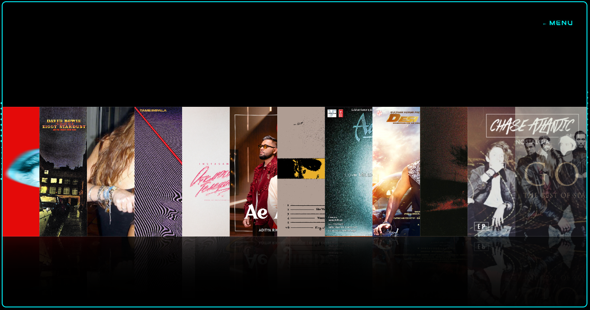
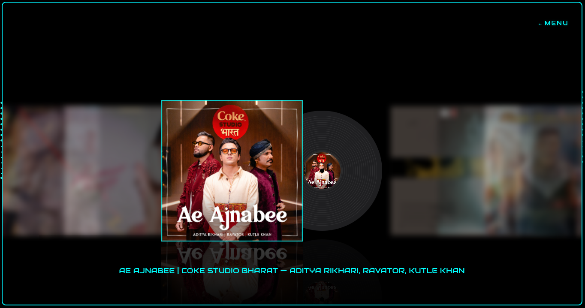
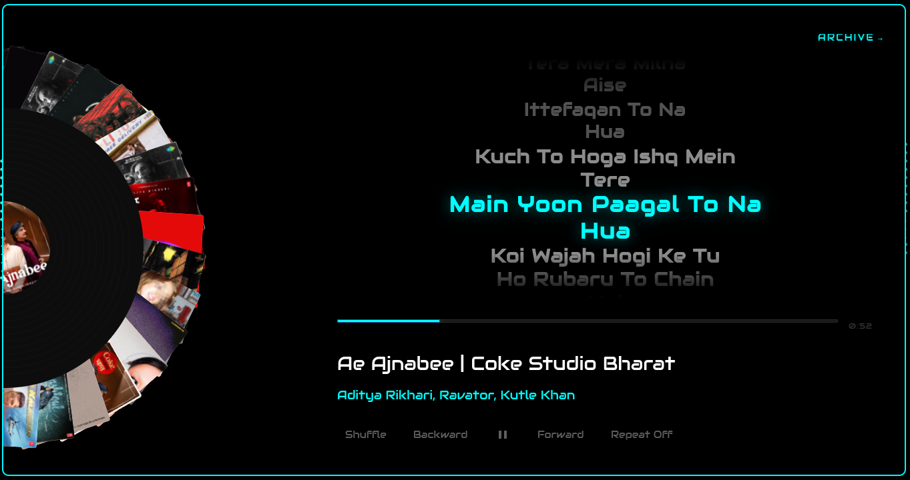

# Ember


**Ember** is a sleek, cinematic music player for Linux (GNOME) — built on top of the open-source Amberol codebase with a completely reimagined visual experience.

> *"your music, archived."*

## Features

- 🎵 **Vinyl Archive View** — An interactive horizontal carousel with cover art that animates like opening a record sleeve
- 🎡 **Circular Vinyl Carousel** — A spinning carousel of upcoming songs rendered around a vinyl record in the Now Playing screen
- 📝 **Live Lyrics** — Real-time lyrics that scroll and highlight in sync with the song (Spotify-style)
- ♾️ **Infinite Looping Carousel** — Automatically enables infinite looping when you have more than 12 songs loaded
- 🔍 **Folder & File Import** — Load individual songs or full folders from the main menu
- 🎨 **Custom Dark Theme** — Premium dark neon-teal aesthetic with glassmorphism and animated transitions
- 🔊 **GStreamer Audio Backend** — Reliable audio playback using GStreamer, supporting MP3, FLAC, OGG, and more

## Screenshots

### 🖥️ Main Menu (Start Screen)


### 📂 Archive View (Horizontal Carousel)


### 📀 Album Focus (Vinyl Pop-out)


### 🎵 Now Playing & Synced Lyrics


## Building from Source

### Prerequisites

You need the following installed on your system:

- [Rust](https://rustup.rs/) (stable toolchain)
- GTK4 development libraries
- GStreamer + plugins
- Meson build system
- Python3 + `blueprint-compiler` (via meson subproject, fetched automatically)

**On Arch Linux:**
```bash
sudo pacman -S gtk4 gstreamer gst-plugins-base gst-plugins-good meson
```

**On Fedora:**
```bash
sudo dnf install gtk4-devel gstreamer1-devel gstreamer1-plugins-base-devel meson
```

**On Ubuntu/Debian:**
```bash
sudo apt install libgtk-4-dev libgstreamer1.0-dev libgstreamer-plugins-base1.0-dev meson
```

### Build

```bash
meson setup build
ninja -C build
```

### Run

```bash
./run.sh
```

Or directly:
```bash
GSETTINGS_SCHEMA_DIR=./build/data ./build/src/amberol
```

## Windows Port

Ember is fully ported to Windows (x86_64).
You can build directly using PowerShell:
```powershell
.\build-windows.ps1
```

Or generate a standalone distribution package with bundled runtime DLLs:
```powershell
.\build-windows.ps1 -Bundle
```

See the [Windows Port Guide](./windows_port_guide.md) for setup requirements, toolchain options (MSYS2 UCRT64), and distribution details.

## License

Ember is released under the terms of the **GNU General Public License v3.0 or later**.

Original Amberol codebase © 2022 Emmanuele Bassi.
Modifications and new features © 2026 Shashank (shanks).
